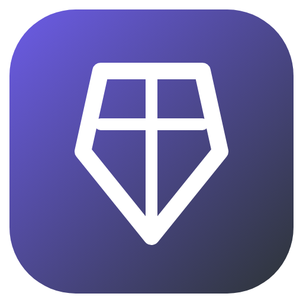

<h1 align="center">ForbiddenEnchants: Full Russian Localization</h1>

  Complete Russian translation for ForbiddenEnchants plugin v1.0.4: messages, editors, GUI menus, and commands. 
  Полная русская локализация плагина ForbiddenEnchants v1.0.4: сообщения, редакторы, GUI меню и команды.

  
  
  

  <a href="#english">English</a> | <a href="#русский">Русский</a>

---

## English

### Overview

This repository provides clean, standalone Russian localization files for **ForbiddenEnchants v1.0.4**.
It contains only configuration and text files to respect original author licensing and copyright requirements.

### Files

- `messages.yml`: All 464 keys translated.
- `config.yml`: Localized comments.

### Installation

1. Copy `messages.yml` into `plugins/ForbiddenEnchants/messages.yml`.
2. Or download pre-built `.jar` from [Releases](https://github.com/milkycloud-dev/forbiddenenchants-full-russian-localization/releases/latest).

### Releases

Pre-built ready-to-use binaries (`.jar` / `.zip`) are available for download in [Releases](https://github.com/milkycloud-dev/forbiddenenchants-full-russian-localization/releases/latest).

### License

MIT License. Created by milkycloud-dev (2026).

---

## Русский

### Описание

Репозиторий содержит чистые файлы русской локализации для **ForbiddenEnchants v1.0.4**.
В состав включены исключительно файлы конфигурации и переводов, без бинарных сборок, с соблюдением требований лицензий авторов.

### Файлы

- `messages.yml`: Все 464 ключа переведены на русский язык.
- `config.yml`: Локализованные комментарии.

### Установка

1. Скопируйте файл `messages.yml` в `plugins/ForbiddenEnchants/messages.yml`.
2. Либо скачайте готовую сборку `.jar` из раздела [Releases](https://github.com/milkycloud-dev/forbiddenenchants-full-russian-localization/releases/latest).

### Релизы

Готовые собранные бинарные пакеты (`.jar` / `.zip`) доступны для загрузки в разделе [Releases](https://github.com/milkycloud-dev/forbiddenenchants-full-russian-localization/releases/latest).

### Лицензия

MIT License. Создано milkycloud-dev (2026).
